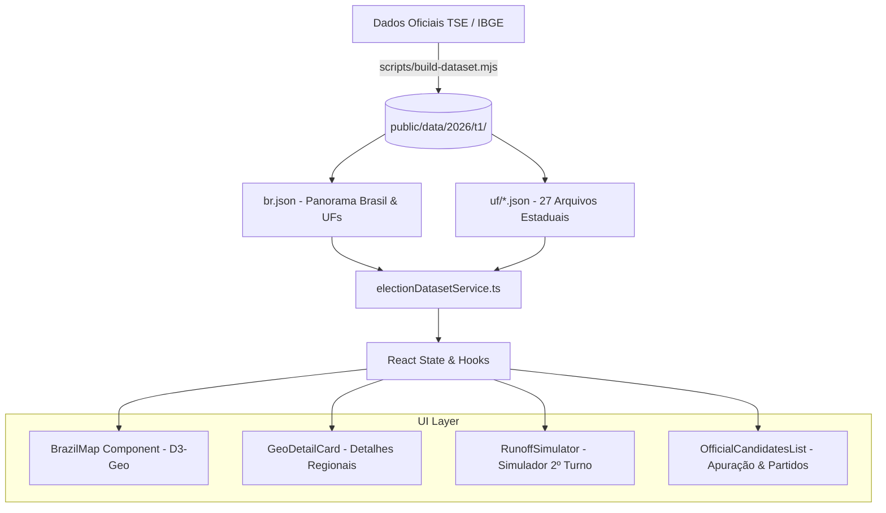

<div align="center">

# 🗳️ Painel Eleições 2026 · Panorama & Apuração Oficial

**Plataforma de alta performance para visualização geoespacial, apuração em tempo real e simulação do 2º turno das Eleições Gerais de 2026 com dados reais do TSE.**

[](https://react.dev/)
[](https://www.typescriptlang.org/)
[](https://vitejs.dev/)
[](https://tailwindcss.com/)
[](https://d3js.org/)
[](LICENSE)

[Funcionalidades](#-principais-funcionalidades) • [Destaques Técnicos](#-desafios-e-soluções-técnicas) • [Arquitetura](#-arquitetura-do-projeto) • [Como Executar](#-como-executar-localmente) • [Estrutura](#-estrutura-de-arquivos)

</div>

---

## 📌 Sobre o Projeto

O **Painel Eleições 2026** é uma aplicação web desenvolvida para fornecer visualização de dados eleitorais no Brasil. O sistema integra dados oficiais do Tribunal Superior Eleitoral (TSE) do 1º turno das Eleições de 2026 e das pesquisas eleitorais registradas, permitindo:

1. **Navegação Geoespacial Completa**: Visualização interativa dos 26 estados + Distrito Federal, com *drill-down* granular para as 5 regiões, mesorregiões, microrregiões e os **5.570 municípios brasileiros**.
2. **Apuração Multi-Cargo 100% Real**: Acompanhamento detalhado dos votos e percentuais para **Presidente**, **Governadores** (específicos de cada UF) e **Senadores**.
3. **Simulador Dinâmico de 2º Turno (Regra 50%+1)**: Motor de projeção eleitoral interativo para testar cenários, migração de votos e maiorias matemáticas necessárias para vitória.
4. **Transmissão e Sincronização em Background**: Atualização periódica silenciosa sem travar a interface e sem necessidade de clique manual.

---

## 🚀 Principais Funcionalidades

- 🗺️ **Mapa do Brasil Interativo (D3-Geo & SVG)**:
  - Renderização vetorial fluida com projeção planar ajustada para o território nacional.
  - Hover com estatísticas instantâneas (total de votos válidos, líder, porcentagem e margem).
  - Zoom e Pan dinâmicos com *fitExtent* automático ao focar em um estado ou município.
  - Identificação de cores padronizadas para todos os 28 partidos políticos brasileiros (PT, PL, União Brasil, MDB, PSD, Republicanos, etc.).

- 🏛️ **Drill-down Estadual & Municipal**:
  - Ao clicar em qualquer estado, o sistema isola a unidade federativa e carrega a malha de municípios e divisões regionais do IBGE.
  - Exibição dos candidatos locais do estado selecionado (ex.: governadores e senadores de SP, RJ, PE, MG, RS, etc.).

- ⚖️ **Simulador Oficial de 2º Turno**:
  - Cálculo instantâneo da margem necessária para 50% + 1 voto válido.
  - Sliders e seletores para transferir votos de candidatos eliminados e simular cenários de comparecimento e abstenção.

- 📊 **Painel de Estatísticas Globais**:
  - Contagem total de seções totalizadas, abstenção, votos nulos e brancos, e votos válidos.
  - Distribuição percentual em barras de progresso animadas e ordenação em tempo real.

- 🔍 **Mecanismo de Busca Rápida**:
  - Filtro em tempo real por candidato, número de urna, partido, estado ou cidade.

---

## 💡 Desafios e Soluções Técnicas

### 1. Otimização de Carga Geoespacial (5.570 Municípios)
Carregar o GeoJSON completo de todos os municípios brasileiros de uma só vez geraria um payload superior a **120 MB**, degradando o tempo de carregamento e a memória do navegador.
- **Solução**: Arquitetura em *chunks* sob demanda particionados por Unidade Federativa (`/data/2026/t1/uf/{UF}.json`). A malha nacional carrega apenas as 27 UFs inicialmente (~300 KB), e a malha municipal do IBGE é baixada e cacheada em memória apenas quando o usuário faz o *drill-down* naquele estado.

### 2. Projeção Planar Cartográfica (IBGE GeoJSON & D3)
Muitas geometrias fornecidas pelo IBGE possuem orientação horária dos polígonos, o que em projeções esféricas tradicionais (`geoMercator`) causava oclusão ou inversão de hemisfério (*winding order*).
- **Solução**: Uso da projeção planar `d3.geoIdentity().reflectY(true).fitExtent(...)`, garantindo renderização instantânea com proporção cartográfica perfeita e suporte a múltiplos níveis de zoom sem perda de nitidez.

### 3. Matriz de Votos e Mapeamento de Candidatos por Estado
Nas eleições brasileiras, enquanto a disputa presidencial é unificada, cada um dos 27 estados possui sua própria chapa de governadores e senadores, com números de urna e partidos concorrendo simultaneamente.
- **Solução**: Implementação de um serviço centralizado (`electionDatasetService.ts`) que mapeia o cargo ativo (`'pres' | 'gov' | 'sen'`) e a UF, garantindo que o candidato vitorioso no município ou na mesorregião corresponda com fidelidade à sua respectiva cédula eleitoral estadual.

---

## 🏗️ Arquitetura do Projeto



---

## 🛠️ Stack Tecnológica

| Camada | Tecnologia | Propósito |
|---|---|---|
| **Frontend** | React 19 + TypeScript | UI reativa, tipagem estrita de payloads e lifecycle |
| **Estilização** | Tailwind CSS v4 | Estilização utilitária de alto desempenho sem overhead |
| **Visualização** | D3-geo + D3-zoom | Cálculos cartográficos, projeções e controle de zoom SVG |
| **Build Tool** | Vite 8 | Bundler ultra-rápido com HMR e compilação em sub-segundo |
| **Ícones & Animação** | Lucide React + Motion | Micro-interações, ícones modernos e feedbacks visuais |
| **Dados** | TSE Dados Abertos + IBGE Malhas | Base fidedigna de votos apurados e geometrias |

---

## 📦 Estrutura de Arquivos

```
Eleicao-2026/
├── public/
│   ├── favicon.svg               # Ícone temático da aplicação
│   └── data/
│       └── 2026/t1/
│           ├── br.json           # Sumário nacional e UFs (Pres, Gov, Sen)
│           └── uf/               # Dados municipais de cada um dos 27 estados
├── scripts/
│   └── build-dataset.mjs         # Pipeline de extração e formatação dos dados TSE
├── src/
│   ├── components/
│   │   ├── Map/
│   │   │   ├── BrazilMap.tsx     # Componente principal do mapa com SVG + D3
│   │   │   └── GeoDetailCard.tsx # Painel lateral com apuração do estado/município
│   │   ├── ElectionHeader.tsx    # Cabeçalho com status ao vivo e filtros
│   │   ├── OfficialCandidatesList.tsx # Listagem e classificação de candidatos
│   │   ├── RunoffSimulator.tsx   # Simulador matemático de 2º turno (50%+1)
│   │   ├── QuickSearchModal.tsx  # Busca instantânea de candidatos e cidades
│   │   └── Polls/                # Acompanhamento de pesquisas registradas
│   ├── services/
│   │   ├── electionDatasetService.ts # Processamento de matrizes de votos e cores
│   │   └── electionApi.ts        # Polling e controle de sincronização
│   ├── types/
│   │   └── dataset.ts            # Definições de tipos TypeScript do dataset
│   ├── App.tsx                   # Ponto de entrada da aplicação
│   └── main.tsx
├── index.html                    # Meta tags SEO, OpenGraph e viewport
├── package.json
└── vite.config.ts
```

---

## 💻 Como Executar Localmente

### Pré-requisitos
- [Node.js](https://nodejs.org/) versão 18 ou superior
- Gerenciador de pacotes `npm` ou `yarn`

### 1. Clone o repositório
```bash
git clone https://github.com/Lucaszki/Eleicao-2026.git
cd Eleicao-2026
```

### 2. Instale as dependências
```bash
npm install
```

### 3. Inicie o servidor de desenvolvimento
```bash
npm run dev
```
O painel estará disponível em [http://localhost:3000](http://localhost:3000).

### 4. Build para produção
```bash
npm run build
```
Os arquivos otimizados serão gerados na pasta `dist/`.

---

## 📄 Licença

Este projeto está sob a licença [MIT](LICENSE).

---

<div align="center">
Desenvolvido por <strong>Lucas</strong> • Conecte-se comigo no <a href="https://www.linkedin.com/">LinkedIn</a>
</div>
